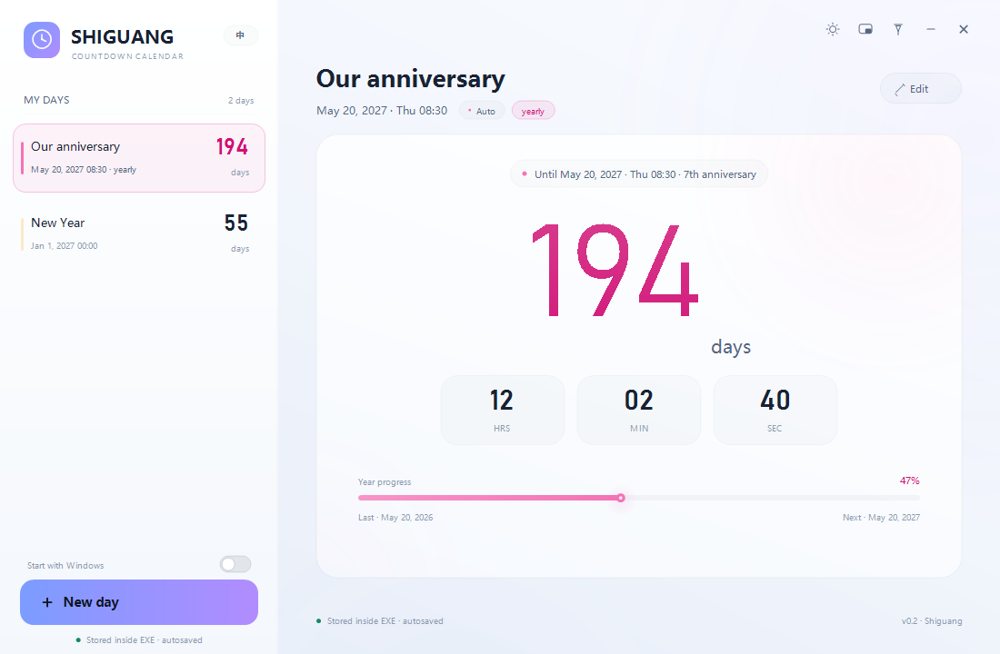
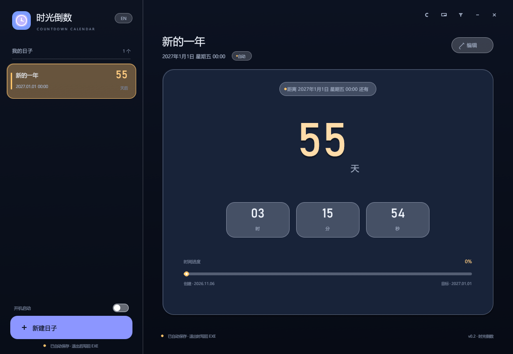
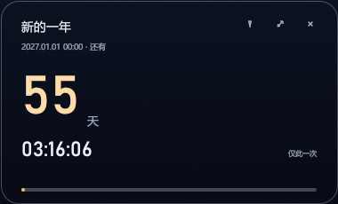

# Shiguang Countdown

A focused countdown calendar for Windows. Pick a date and time, then watch the remaining days, hours, minutes, and seconds. Count up from the past, repeat anniversaries every year, and keep all settings inside the executable — no external configuration files.

Shiguang Countdown is available in two functionally equivalent editions:

| Edition | Runtime | Download size |
|---|---|---|
| C# | Windows 10/11 built-in .NET Framework 4.8 | ~123 KB |
| Rust | None (fully self-contained) | ~3.4 MB |

## Features

- **Countdown and count-up** — count down to a future moment, count up from a past one, or let the app choose automatically.
- **Yearly anniversaries** — repeats use the next occurrence, show the anniversary number, and display progress through the current year.
- **Themes** — light, dark, and follow-system, switchable at runtime.
- **English and Chinese UI** — switch languages without restarting.
- **Resizable window and mini mode** — a compact always-available view, plus optional always-on-top.
- **Start with Windows** — optional, stored in the current user's startup configuration.
- **Self-contained settings** — the JSON configuration is embedded in the exe and written back on exit.
- **No telemetry, no network access, no installer.**

## Screenshots

<p align="center">
  
  
</p>
<p align="center">
  
</p>

## Download

Get the latest Windows executables from the [Releases page](https://github.com/Kesike03/shiguang-countdown/releases/latest):

- `ShiguangCountdown-CSharp.exe` — smallest download; requires the .NET Framework 4.8 that ships with Windows 10 and 11.
- `ShiguangCountdown-Rust.exe` — recommended if you want a completely self-contained binary with no runtime dependency.

Both are portable single files. Place the executable in a folder where you have write permission; the app rewrites its own exe when settings change.

## Quick start

1. Run either executable.
2. A sample event is created on first launch. Select it and click **Edit**, or click **New day**.
3. Set a title, date, time, mode, color, and yearly-repeat option.
4. Save, then close the window normally so the configuration is written back to the exe.

## How settings are stored

There is no `.ini`, `.json`, or registry value for application data. The configuration is a UTF-8 JSON document embedded at the end of the executable:

```
[ original PE image ][ magic ][ length ][ JSON ][ CRC32 ]
```

On exit, the app starts a temporary helper copy of itself. The helper waits for the original process to exit, writes the new trailer, and retries if Windows temporarily locks the file. If the exe is in a read-only location, settings cannot be saved; move it to a writable folder.

The only OS-level state is the optional **Start with Windows** entry. The C# edition uses `HKCU\Software\Microsoft\Windows\CurrentVersion\Run` and falls back to a shortcut in the user's Startup folder. The Rust edition uses the same `HKCU` Run key through `reg.exe`.

## Build from source

### C# edition

Requirements:

- Windows 10 or 11
- .NET Framework 4.8 (the in-box compiler reference assemblies)
- A .NET SDK, used only to obtain Roslyn's `csc.dll`

From the repository root:

```powershell
pwsh -File build/build.ps1 -Name ShiguangCountdown.exe
```

The executable is written to `dist/ShiguangCountdown.exe`. The script locates Roslyn from a standard .NET SDK installation or the Scoop `dotnet-sdk` package.

### Rust edition

Requirements:

- A Rust toolchain targeting `x86_64-pc-windows-gnu`
- MinGW-w64 tools, including `windres` (used to embed the application icon)

```powershell
cd rust
rustup target add x86_64-pc-windows-gnu
cargo build --release --target x86_64-pc-windows-gnu
```

The executable is written to `rust/target/x86_64-pc-windows-gnu/release/shiguang.exe`. The included `rust/.cargo/config.toml` enables `link-self-contained=yes` so the GNU target links without external `libgcc` DLLs.

## Project layout

```
src/                 C# WinForms application (custom GDI+ UI)
build/               C# build script, manifest, and icon
rust/src/            Rust/egui application
rust/build.rs        Embeds the Windows icon resource
docs/screenshots/    README screenshots
```

## Known limitations

- The executables are unsigned, so Windows SmartScreen may show a warning on first run.
- The exe must be writable for settings to persist.
- Starting with Windows can be blocked by corporate policy or security software.
- The C# edition needs .NET Framework 4.8; the Rust edition does not.

## License

Copyright (C) 2026 Kesike03.

This project is free software: you can redistribute it and/or modify it under the terms of the GNU General Public License as published by the Free Software Foundation, either version 3 of the License, or (at your option) any later version.

This project is distributed in the hope that it will be useful, but WITHOUT ANY WARRANTY; without even the implied warranty of MERCHANTABILITY or FITNESS FOR A PARTICULAR PURPOSE. See the [GNU General Public License](LICENSE) for details.
